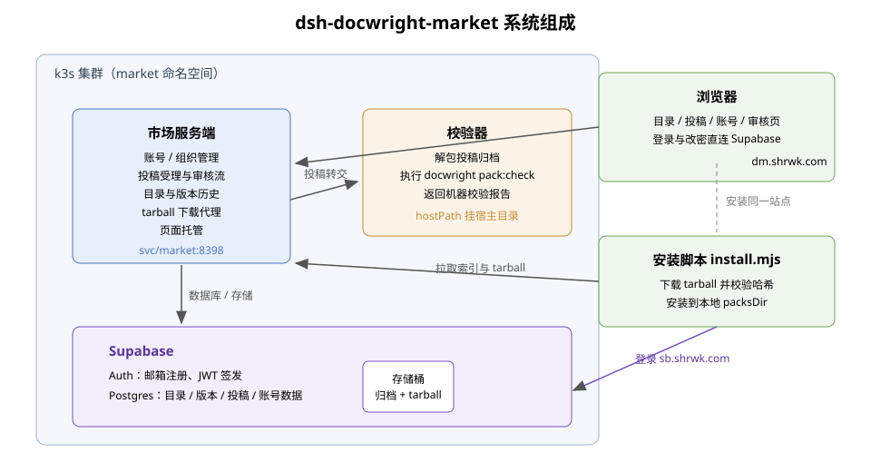

# 系统组成

## 功能组件

系统由四个功能组件构成：

| 组件 | 职责 |
|---|---|
| 市场服务端 | 处理全部业务请求：账号与组织、投稿受理、审核流、目录与版本历史、tarball 下载、页面托管 |
| 校验器 | 接收服务端转交的投稿归档，解包并执行 docwright 的 `pack:check`，返回校验报告 |
| Web 页面 | 浏览器侧的目录、投稿、账号、审核等页面，经市场服务端访问 |
| Supabase | 提供账号认证（邮箱注册、JWT 签发）、业务数据库与对象存储（投稿归档桶 `uploads`、公开 tarball 桶 `tarballs`） |

## 组件关系

浏览器页面与安装脚本只与市场服务端通信。服务端在收到投稿后调用校验器执行机器校验，校验通过才把投稿放入审核队列；审核通过后由服务端把 tarball 写入存储并更新目录数据。认证由 Supabase 承担，页面直接使用浏览器侧的 Supabase 公网地址完成登录，服务端验证请求携带的 JWT。

## 关键约定

### 校验以 docwright 自身规则为准

机器校验直接运行 docwright 自己的 `pack:check`，校验器不重新实现任何 pack 规则。因此机器校验通过等价于该 pack 在 docwright 本地检查全绿。

### 两级审核门

投稿需要先后通过两道门。机器门拦截全部可以自动判定的不合格投稿，只有通过的投稿进入审核队列；人工门由审核员阅读机器无法判定的内容，重点是 pack 描述与实际行为的一致性以及 `rules/functions.js` 这类可执行代码。安装脚本只复制文件并校验哈希，不执行 pack 内容，人工审核是这类可执行代码进入用户环境的唯一关口。

### 地址拆分

Supabase 存在两个访问地址：集群内地址 `SUPABASE_API_URL` 供服务端使用，公网地址 `PUBLIC_SUPABASE_URL` 经 `/config.json` 下发给浏览器。集群内部地址不出现在任何面向浏览器的响应中，tarball 下载因此由服务端代理而不是重定向。

### 部署形态

系统部署在本机 k3s 的 `market` 命名空间。校验器需要访问宿主上的 docwright 与 harness 目录以获得与本地一致的检查环境，采用 hostPath 挂载，属于单节点部署语义。详见 [06-deployment.md](06-deployment.md)。

## 详档

组件边界、数据模型与完整 API 面见 [architecture.md](../architecture.md)。
