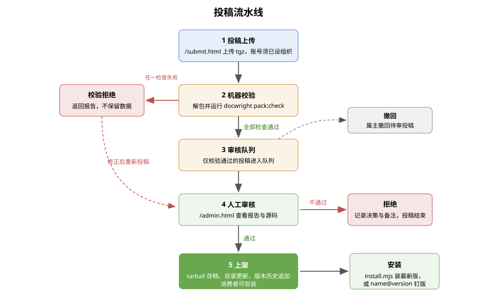

# 投稿与发布流程

## 流程总览

一个 pack 从投稿到可安装，依次经过五个阶段：

1. **准备**：作者登录后在账号页设置发布者组织（首次投稿前必须完成）。
2. **上传**：作者在 `/submit.html` 上传 pack 目录的 `.tgz` 归档（不超过 50 MB），填写 author、category、license（SPDX 白名单）、homepage（可选）。
3. **机器校验**：系统立即解包并执行 docwright 的 `pack:check`，实时返回校验报告。全部检查通过才进入审核队列；校验失败的投稿不保留任何数据，作者修正后重新上传。
4. **人工审核**：审核员在 `/admin.html` 查看机器报告、文件树与源码，做出通过或拒绝的决定并附备注。通过即上架。
5. **上架与安装**：上架动作把审核对象的原样 tarball 存入公开存储、更新目录条目、在版本历史中追加一行，并记录发布者组织。此后消费者即可安装。

## 机器强制规则

机器校验与服务端在投稿受理时执行以下规则，全部不可绕过：

| 规则 | 违反结果 |
|---|---|
| `manifest.name` 必须为 kebab-case 且与目录名一致 | 拒收 |
| 不得与 docwright 内置的六个 cosmic-* pack 重名 | 拒收 |
| 归档内不得存在不属于任何合法 pack 的文件或目录 | 拒收 |
| `pack:check` 每种语言的 golden 检查全绿 | 不进入审核队列 |
| 投稿账号已设置发布者组织 | 返回 403 |
| 同一 pack 名只允许一个待审投稿 | 返回 409 |
| (name, version) 组合在全部历史中唯一，删除 pack 也不释放 | 返回 409 |
| 更新投稿必须来自原属主账号 | 返回 403 |
| 更新版本号必须严格大于已发布的最大版本（semver 含 pre-release 排序） | 返回 409 |
| 更新的内容哈希必须与已发布版本不同，仅提升版本号不算更新 | 返回 409 |

## 审核决定

- **通过**：立即上架。tarball 从投稿归档原样发布，保证审核对象与发布对象一致；版本历史追加一行，全部历史版本的 tarball 均可下载。
- **拒绝**：记录决策与备注，投稿结束，不影响后续重新投稿。
- **撤回**：属主可在投稿历史中撤回仍处于待审状态的投稿。

## 套件（suite）

除单个 pack 外，作者还可以提交套件：一组精选 pack 的具名组合。套件投稿是一份表单而非归档，不经过机器校验，直接进入同一条人工审核队列；审核通过后出现在目录中。消费者通过 docwright 插件的整套安装功能安装套件内的全部成员 pack。

## 详档

业务规则的完整清单见 [features.md](../features.md)。
